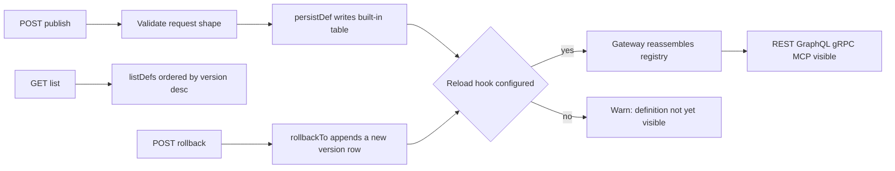

# meta-store

**A definition control plane: seven HTTP endpoints that publish, list and roll back schema and workflow definitions — while the definitions themselves stay in the host's built-in tables `__schemaDef` / `__workflowDef`. Built for teams that run several data applications and need every definition to have a version, an author and a way back.**


> 中文: [README.md](./README.md)

- One process serves exactly one `(tenant, env)`; more environments mean more processes, not more registries inside one.
- The endpoints orchestrate and forward. Version comparison, persistence and registration verdicts all stay on the store side.
- HTTP is built on `node:http`, with zero web-framework dependency.

## Friday, 17:40 — definitions scattered across four repositories

A team runs three data applications: orders, inventory, billing. Between them they own 11 schema definitions and 2 workflow definitions, spread over 4 repositories.

One day the order application needs a `price` field. An engineer edits the JSON in repository A, asks in the team channel which version production is running, then connects to Mongo by hand to insert a record. Two weeks later the field type is wrong. Rolling back to the previous version means reading git history and rebuilding the old JSON from memory.

Nowhere in that process is there a single command that answers three questions at once: **which version is live, who published it, and how do we go back**. Where the version number lives and which line a rollback must touch are things people remember. Remembering wrong raises no error — production just keeps running a definition nobody audited.

`meta-store` turns those three questions into three HTTP actions. It does not parse schemas, compile queries or touch business data. It only moves a definition from "a JSON file in a repository" to "a row with a version number, an author and an append-only path back".

## What it actually does

It is a narrow bridge: HTTP requests on one side, the host `nodejs-store` metadef façade on the other (`persistDef` / `listDefs` / `rollbackTo`, plus the workflow counterparts). The bridge invents no semantics of its own.

| It does | It refuses to do |
|---|---|
| Validate request shape (`defn.name` non-empty, `version` an integer) | Parse field types or judge schema validity |
| Call `persistDef`: bump the version, stay idempotent for an identical definition | Compile queries or make permission decisions |
| Call `listDefs`, returning history in `version desc` order | Cache, paginate or manage business data |
| Call `rollbackTo`, appending a new version row | Rewrite any historical row |
| Fire one reload hook after a successful publish or rollback | Restart the gateway or assemble protocol surfaces directly |

Both definition kinds share one set of semantics and differ only in their table: schemas go to `__schemaDef`, workflows to `__workflowDef`. The row shape is identical:

```text
{_id, tenant, env, name, version, defn, status, createdBy}
```

Seven endpoints, every one of them implicitly filtered by the instance's current `(tenant, env)`:

| Method | Path | Request | Success | Failure |
|---|---|---|---|---|
| `GET` | `/meta/health` | — | `{data:{ok,tenant,env}}` | — |
| `GET` | `/meta/defs?name=<n>` | — | `{data:[row,...]}` | 400 |
| `POST` | `/meta/defs` | `{defn, actor?}` | `{data:row}` | 400 / 403 / 409 |
| `POST` | `/meta/defs/:name/rollback` | `{version, actor?}` | `{data:row}` | 400 / 404 |
| `GET` | `/meta/workflowDefs?name=<n>` | — | `{data:[row,...]}` | 400 |
| `POST` | `/meta/workflowDefs` | `{defn, actor?}` | `{data:row}` | 400 / 403 / 409 |
| `POST` | `/meta/workflowDefs/:name/rollback` | `{version, actor?}` | `{data:row}` | 400 / 404 |

## Key mechanisms

### Publish: compare the shape first, then decide whether the version moves

`POST /meta/defs` receives `{defn, actor?}`, checks that `defn.name` is a non-empty string, then hands `defn` to `store.persistDef`. The host reads the latest row for `(tenant, env, name)` and deep-compares using a stable, key-order-independent serialization:

- **Same name, same shape** → return that row; no new version is inserted.
- **Same name, different shape** → the new version is `max(version) + 1`, inserted with `status: "active"` and `createdBy` taken from `actor` (empty string by default).

Version uniqueness lives in the row's natural key rather than in an index: `_id = tenant + U+001F + env + U+001F + name + U+001F + version`. When two requests compute the same version concurrently, the later one hits a unique-key conflict in storage and the control plane maps it to **409 `CONFLICT`** — no retry, no swallowing, no duplicate version.

A persisted `defn` is pure JSON. Computed columns carry only an `fnRef` string; the function implementation is injected by the integrator at host `register` time. That boundary matters: the control plane moves serializable definitions, never executable code.

### List: one version timeline per `(tenant, env)`

`GET /meta/defs` and `GET /meta/workflowDefs` forward straight to `listDefs`. The condition is fixed to the instance's `(tenant, env)`, an optional `?name=` narrows to a single definition, and ordering is always `version desc`.

The control plane keeps no state and no cache, so a listing always equals what the database holds at that moment. With `name` omitted it returns every definition in that isolation dimension; definitions from two different `(tenant, env)` pairs never appear together.

### Roll back: write a new version, never edit history

`POST /meta/defs/:name/rollback` accepts `{version, actor?}`. The host first looks for the target version among that name's historical rows:

- Not found → throws `版本不存在`, which the control plane maps to **404 `NOT_FOUND`**.
- Found → takes that row's `defn`, runs it through `persistDef` semantics again, and **appends a new version row**.

So `version` does not shrink after a rollback — it keeps growing. Historical rows are untouched and the audit chain stays whole. If the target content happens to equal the current latest row (same name, same shape), idempotency wins: the latest row is returned and no new version is added.

The three workflow endpoints mirror the schema endpoints exactly, and rollbacks land in `__workflowDef` the same append-only way.

### Zero business semantics: the endpoints forward, the store judges

Of the 7 endpoints, 6 each correspond to one store call; the seventh is `GET /meta/health`. The control plane never reads or writes MongoDB tables directly, and knows nothing about fields, relations or permissions.

After a successful publish or rollback it calls `afterPublish`: with `META_RELOAD_HOOK` configured it sends one `POST` so the gateway can reassemble its registry; without the hook the publish still succeeds but logs a `console.warn` — the fact that the new definition is invisible to the protocol surfaces is never silently dropped. A non-2xx hook response makes the publish return **500 `ERR_RELOAD_FAILED`** explicitly.

Errors surface on the same principle: `message` is passed through verbatim, never rewritten or smoothed over.

| Situation | Status | code |
|---|---|---|
| Malformed request JSON, missing `defn.name`, non-integer `version` | 400 | `BAD_REQUEST` |
| Definition-layer permission denial (`ERR_PERMISSION:` prefix) | 403 | `PERMISSION` |
| Missing context (`no_context` / `ERR_NO_CONTEXT:` prefix) | 403 | `NO_CONTEXT` |
| Rollback target version missing, unmatched path | 404 | `NOT_FOUND` |
| Concurrent write of the same version | 409 | `CONFLICT` |
| Non-2xx reload hook, any other database or connection error | 500 | original `code` |

A missing required environment variable produces no HTTP response at all: `loadConfig` throws `ERR_META_CONFIG` during construction and the process exits.

## Run it

The server lives in `node/`. It depends on the Rust native core of `nodejs-store`, loaded from npm; it needs Node.js 18+ and a reachable MongoDB.

```bash
cd node
npm install
META_TENANT=acme META_ENV=dev MONGO_URI=mongodb://127.0.0.1:27017 META_PORT=8600 npm start
# => meta-store listening on http://127.0.0.1:8600 (tenant=acme env=dev)
```

Three variables are required: `META_TENANT`, `META_ENV`, `MONGO_URI`. `META_DB` defaults to `meta_store`, `META_PORT` to `8600`. The npm package is `meta-store-node` (currently `0.2.5`); it has no `bin` field — the entry point is `src/index.js`.

Publish a definition and inspect the response:

```bash
curl -X POST http://127.0.0.1:8600/meta/defs \
  -H 'content-type: application/json' \
  -d '{"defn":{"name":"Order","fields":{"_id":{"type":"string"},"title":{"type":"string"}}},"actor":"alice"}'
```

```json
{
  "data": {
    "_id": "acme\u001fdev\u001fOrder\u001f1",
    "tenant": "acme",
    "env": "dev",
    "name": "Order",
    "version": 1,
    "defn": {
      "name": "Order",
      "fields": { "_id": { "type": "string" }, "title": { "type": "string" } }
    },
    "status": "active",
    "createdBy": "alice"
  }
}
```

Then publish a reshaped version, list the history, and roll back to v1:

```bash
# Reshaped definition -> version 2
curl -X POST http://127.0.0.1:8600/meta/defs \
  -H 'content-type: application/json' \
  -d '{"defn":{"name":"Order","fields":{"_id":{"type":"string"},"title":{"type":"string"},"price":{"type":"number"}}}}'

# List: version desc
curl 'http://127.0.0.1:8600/meta/defs?name=Order'

# Roll back to v1: appends version 3, historical rows untouched
curl -X POST http://127.0.0.1:8600/meta/defs/Order/rollback \
  -H 'content-type: application/json' -d '{"version":1}'
```

The last response is again `{data: row}`, with `version` equal to `3` and `defn.fields` back to the two-field shape of v1. Request and response shapes follow `spec/00-protocol.md`; the version numbers and rollback assertions come from `node/test/smoke.test.js`.

## Boundaries: when not to use it

- **No authentication or authorization.** The server binds to `127.0.0.1` by default; exposure and identity belong to the gateway and definition-layer permissions. It does not know users.
- **No schema compilation.** Field types, relations, computed columns and query-plan validity are judged by the core and the host; the control plane only moves JSON. A definition that persists successfully here is not automatically a definition a protocol surface can assemble.
- **No business data management.** There are no CRUD endpoints for business tables and no data migration. That is the job of protocol skins such as `store-api`.
- **No multi-tenant admin UI or approval flow.** One process recognizes one `(tenant, env)`; multiple tenants and environments are handled by running multiple instances at the deployment layer.
- **The first version stores definitions in MongoDB only.** MySQL / PostgreSQL can serve as business-data backends but cannot host this definition store.
- **No function values.** `defn` must be pure JSON, computed columns carry only `fnRef`, and executable implementations stay in the integrator's `register` call.

## Where it sits in the family

It sits between the host and the protocol surfaces: upward it calls the `nodejs-store` metadef façade to write the built-in definition tables; downward it uses the reload hook so `store-gateway` rebuilds its registry and every skin becomes visible again; the publish script generated by the `create-store-app` scaffold calls its `POST /meta/defs`.

| Layer | Repository |
|---|---|
| Engine | [rust-store](https://github.com/coenddt/rust-store) |
| Hosts | [nodejs-store](https://github.com/coenddt/nodejs-store) · [py-store](https://github.com/coenddt/py-store) |
| Protocol skins | [store-api](https://github.com/coenddt/store-api) · [store-graphql](https://github.com/coenddt/store-graphql) · [store-grpc](https://github.com/coenddt/store-grpc) · [store-mcp](https://github.com/coenddt/store-mcp) |
| Combiner | [store-gateway](https://github.com/coenddt/store-gateway) |
| Bootstrap plugins | [store-rbac-bootstrap](https://github.com/coenddt/store-rbac-bootstrap) · [store-resource-bootstrap](https://github.com/coenddt/store-resource-bootstrap) |
| Scaffold | [create-store-app](https://github.com/coenddt/create-store-app) |

## The whole thing on one page



In three sentences: a publish writes exactly one versioned row; a listing always equals what the database holds at that moment; a rollback appends a new version rather than rewriting history.

MIT License © 2026 丁滔
