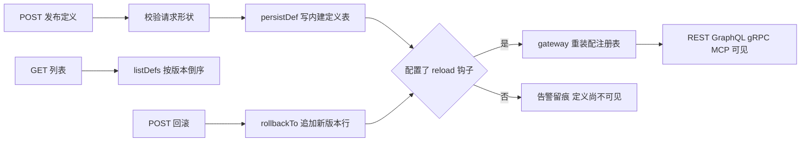

# meta-store

**定义控制面：把 schema 与 workflow 定义的发布、列表、回滚收成 7 个 HTTP 端点。定义本身不在这里，它们落在宿主 `nodejs-store` 的内建表 `__schemaDef` / `__workflowDef` 里。给维护多个数据应用、需要让定义有版本、有发布人、可回滚的团队用。**


> English: [README.en.md](./README.en.md)

- 一个进程只服务一个 `(tenant, env)`；多环境靠多进程，不靠进程内多 Registry。
- 端点只做编排与转发。版本比对、落库、注册判决全在 store 面。
- HTTP 由 `node:http` 实现，零 Web 框架依赖。

## 周五 17:40，定义散在四个仓库里

一个团队维护三个数据应用：订单、库存、结算。它们共有 11 份 schema 定义和 2 份 workflow 定义，躺在 4 个仓库里。

某天要给订单加一个 `price` 字段。工程师先改仓库 A 的 JSON，再在群里问「线上现在跑的是第几版」，然后手工连 Mongo 补一条记录。两周后字段类型不对，想退回上一版，只能翻 git 历史，凭记忆把旧 JSON 重建出来。

整个过程里，没有一条命令能同时回答三个问题：**现在生效的是哪一版、谁发布的、怎么退回去**。版本号写在哪、回滚该改哪一行，全靠人记。记错了不会报错，只会让线上悄悄跑着一份谁也没审计过的定义。

`meta-store` 把这三个问题收成三个 HTTP 动作。它不解析 schema、不编译查询、不碰业务数据，只负责让定义从「仓库里的 JSON」变成「有版本号、有发布人、可追加式回退的一行记录」。

## 它到底做什么

它是一座很窄的桥：左边是 HTTP 请求，右边是宿主 `nodejs-store` 的 metadef 面（`persistDef` / `listDefs` / `rollbackTo`，以及 workflow 对应门面）。桥本身不产生任何新语义。

| 它做 | 它不做 |
|---|---|
| 校验请求形状（`defn.name` 非空、`version` 为整数） | 不解析字段类型、不校验 schema 合法性 |
| 调 `persistDef`：版本自增，同名同形幂等 | 不编译查询、不做权限判定 |
| 调 `listDefs`，按 `version desc` 返回历史 | 不缓存、不做分页、不管理业务数据 |
| 调 `rollbackTo`，追加一条新版本行 | 不改写任何历史行 |
| 发布/回滚成功后触发一次 reload 钩子 | 不重启网关、不直接装配协议面 |

两类定义共用同一套语义，只是落表不同：schema 走 `__schemaDef`，workflow 走 `__workflowDef`。行的形状完全一致：

```text
{_id, tenant, env, name, version, defn, status, createdBy}
```

七个端点，全部以当前实例的 `(tenant, env)` 为隐式过滤条件：

| 方法 | 路径 | 请求 | 成功响应 | 失败 |
|---|---|---|---|---|
| `GET` | `/meta/health` | — | `{data:{ok,tenant,env}}` | — |
| `GET` | `/meta/defs?name=<n>` | — | `{data:[row,...]}` | 400 |
| `POST` | `/meta/defs` | `{defn, actor?}` | `{data:row}` | 400 / 403 / 409 |
| `POST` | `/meta/defs/:name/rollback` | `{version, actor?}` | `{data:row}` | 400 / 404 |
| `GET` | `/meta/workflowDefs?name=<n>` | — | `{data:[row,...]}` | 400 |
| `POST` | `/meta/workflowDefs` | `{defn, actor?}` | `{data:row}` | 400 / 403 / 409 |
| `POST` | `/meta/workflowDefs/:name/rollback` | `{version, actor?}` | `{data:row}` | 400 / 404 |

## 关键机制

### 发布：先比形状，再决定版本号加不加

`POST /meta/defs` 收到 `{defn, actor?}`，校验 `defn.name` 是非空字符串，然后把 `defn` 交给 `store.persistDef`。宿主先按 `(tenant, env, name)` 取最新一行，用键序无关的稳定序列化做深比较：

- **同名同形** → 直接返回那一行，不插入新版本；
- **同名异形** → 新版本号取 `max(version) + 1`，插入一行 `status: "active"`，`createdBy` 取 `actor`（缺省为空串）。

版本唯一性不在索引层，而在行的自然键上：`_id = tenant + U+001F + env + U+001F + name + U+001F + version`。两个请求同时算出同一个版本号时，后到者在存储层触发唯一键冲突，控制面映射为 **409 `CONFLICT`**——不重试、不吞掉，也不产生重复版本。

持久化的 `defn` 是纯 JSON。计算列只写 `fnRef` 字符串，函数实现由接入方在宿主 `register` 时注入。这条边界很重要：控制面只搬运可序列化的定义，不搬运可执行代码。

### 列表：一条 `(tenant, env)` 的版本时间线

`GET /meta/defs` 与 `GET /meta/workflowDefs` 直接转发 `listDefs`。条件固定为当前实例的 `(tenant, env)`，可选 `?name=` 收窄到单个定义，排序固定 `version desc`。

控制面自己不留状态、不做缓存，因此列表永远等于库里那一刻的真实内容。`name` 缺省时列出该隔离维度下的全部定义；两个不同 `(tenant, env)` 的定义不会互相出现。

### 回滚：写一条新版本，而不是改历史

`POST /meta/defs/:name/rollback` 收 `{version, actor?}`。宿主先在该 name 的历史行里找目标版本：

- 找不到 → 抛 `版本不存在`，控制面映射为 **404 `NOT_FOUND`**；
- 找到 → 取那一行的 `defn`，再走一次 `persistDef` 语义，**追加一条新版本行**。

所以回滚之后 `version` 不是变小，而是继续变大。历史行原封不动，审计链完整。若要回滚到的内容恰好等于当前最新行（同名同形），幂等逻辑生效：返回当前最新行，不再新增版本。

workflow 定义的三个端点与 schema 完全对称，回滚同样追加式落 `__workflowDef`。

### 零业务语义：端点是转发，判决在 store 面

7 个端点里，6 个各对应一次 store 调用，剩下一个是 `GET /meta/health`。控制面不直接读写 MongoDB 表，也不认识字段、关系或权限。

发布与回滚成功后都会调用 `afterPublish`：配了 `META_RELOAD_HOOK` 就 `POST` 一次，让网关重装配注册表；没配则发布仍然成功，但会 `console.warn` 留痕——新定义对协议面不可见这件事不会被静默吞掉。钩子返回非 2xx 时，发布显式返回 **500 `ERR_RELOAD_FAILED`**。

错误按同一原则上浮，`message` 原样透传，不改写、不圆场：

| 情形 | 状态码 | code |
|---|---|---|
| 请求体非法 JSON、缺 `defn.name`、`version` 非整数 | 400 | `BAD_REQUEST` |
| 定义层权限拒绝（`ERR_PERMISSION:` 前缀） | 403 | `PERMISSION` |
| 上下文缺失（`no_context` / `ERR_NO_CONTEXT:` 前缀） | 403 | `NO_CONTEXT` |
| 回滚目标版本不存在、路径未命中 | 404 | `NOT_FOUND` |
| 同版本并发写 | 409 | `CONFLICT` |
| reload 钩子非 2xx、其余数据库/连接错误 | 500 | 原始 `code` |

必填环境变量缺失不产生 HTTP 响应：`loadConfig` 在构造期抛 `ERR_META_CONFIG`，进程直接退出。

## 跑起来

仓库内的服务端在 `node/`。依赖 `nodejs-store` 的 Rust 原生核心，从 npm 依赖加载；需要 Node.js 18+ 和一个可连接的 MongoDB。

```bash
cd node
npm install
META_TENANT=acme META_ENV=dev MONGO_URI=mongodb://127.0.0.1:27017 META_PORT=8600 npm start
# => meta-store listening on http://127.0.0.1:8600 (tenant=acme env=dev)
```

三个必填变量是 `META_TENANT`、`META_ENV`、`MONGO_URI`；`META_DB` 缺省 `meta_store`，`META_PORT` 缺省 `8600`。npm 包名是 `meta-store-node`（当前 `0.2.5`），没有 `bin` 字段，入口是 `src/index.js`。

发布一份定义并看返回值：

```bash
curl -X POST http://127.0.0.1:8600/meta/defs \
  -H 'content-type: application/json' \
  -d '{"defn":{"name":"Order","fields":{"_id":{"type":"string"},"title":{"type":"string"}}},"actor":"alice"}'
```

```json
{
  "data": {
    "_id": "acme\u001fdev\u001fOrder\u001f1",
    "tenant": "acme",
    "env": "dev",
    "name": "Order",
    "version": 1,
    "defn": {
      "name": "Order",
      "fields": { "_id": { "type": "string" }, "title": { "type": "string" } }
    },
    "status": "active",
    "createdBy": "alice"
  }
}
```

再发布一个异形版本、列历史、回滚到 v1：

```bash
# 异形版本 -> version 2
curl -X POST http://127.0.0.1:8600/meta/defs \
  -H 'content-type: application/json' \
  -d '{"defn":{"name":"Order","fields":{"_id":{"type":"string"},"title":{"type":"string"},"price":{"type":"number"}}}}'

# 列表：version desc
curl 'http://127.0.0.1:8600/meta/defs?name=Order'

# 回滚到 v1：追加一条 version 3，历史行不改写
curl -X POST http://127.0.0.1:8600/meta/defs/Order/rollback \
  -H 'content-type: application/json' -d '{"version":1}'
```

最后一条的响应同样是 `{data: row}`，其中 `version` 为 `3`，`defn.fields` 回到 v1 的两字段形状。请求与响应形状对齐 `spec/00-protocol.md`，版本号与回滚断言取自 `node/test/smoke.test.js`。

## 边界：什么时候不要用它

- **不做认证与鉴权。** 服务默认只绑 `127.0.0.1`，外网暴露与身份识别交给网关和定义层权限。它自己不认识用户。
- **不做 schema 编译。** 字段类型、关系、计算列、查询规划的合法性都由内核和宿主判断，控制面只搬运 JSON。一份能让控制面成功落库的定义，不等于一份能被协议面成功装配的定义。
- **不管理业务数据。** 它没有业务表的增删改查端点，也不做数据迁移。那是 `store-api` 等协议皮的职责。
- **不提供多租户管理 UI 与审批流。** 一个进程只认一个 `(tenant, env)`，多租户、多环境由部署层起多实例承担。
- **首版定义存储只支持 MongoDB。** MySQL / PostgreSQL 可以作为业务数据后端，但不能作为这套定义仓库的落点。
- **不保存函数值。** `defn` 必须是纯 JSON，计算列只写 `fnRef`；可执行实现留在接入方的 `register` 调用里。

## 在家族里的位置

它夹在宿主与协议面之间：向上调 `nodejs-store` 的 metadef 面写内建定义表，向下通过 reload 钩子让 `store-gateway` 重建注册表、各协议皮重新可见；脚手架 `create-store-app` 生成工程里的发布脚本会调它的 `POST /meta/defs`。

| 层 | 仓库 |
|---|---|
| 引擎 | [rust-store](https://github.com/coenddt/rust-store) |
| 宿主 | [nodejs-store](https://github.com/coenddt/nodejs-store) · [py-store](https://github.com/coenddt/py-store) |
| 协议皮 | [store-api](https://github.com/coenddt/store-api) · [store-graphql](https://github.com/coenddt/store-graphql) · [store-grpc](https://github.com/coenddt/store-grpc) · [store-mcp](https://github.com/coenddt/store-mcp) |
| 组合器 | [store-gateway](https://github.com/coenddt/store-gateway) |
| 引导插件 | [store-rbac-bootstrap](https://github.com/coenddt/store-rbac-bootstrap) · [store-resource-bootstrap](https://github.com/coenddt/store-resource-bootstrap) |
| 脚手架 | [create-store-app](https://github.com/coenddt/create-store-app) |

## 一图看懂



三句话：发布只写一行带版本号的记录；列表永远等于库里那一刻的真相；回滚是追加新版本，不是改写历史。

MIT License © 2026 丁滔
